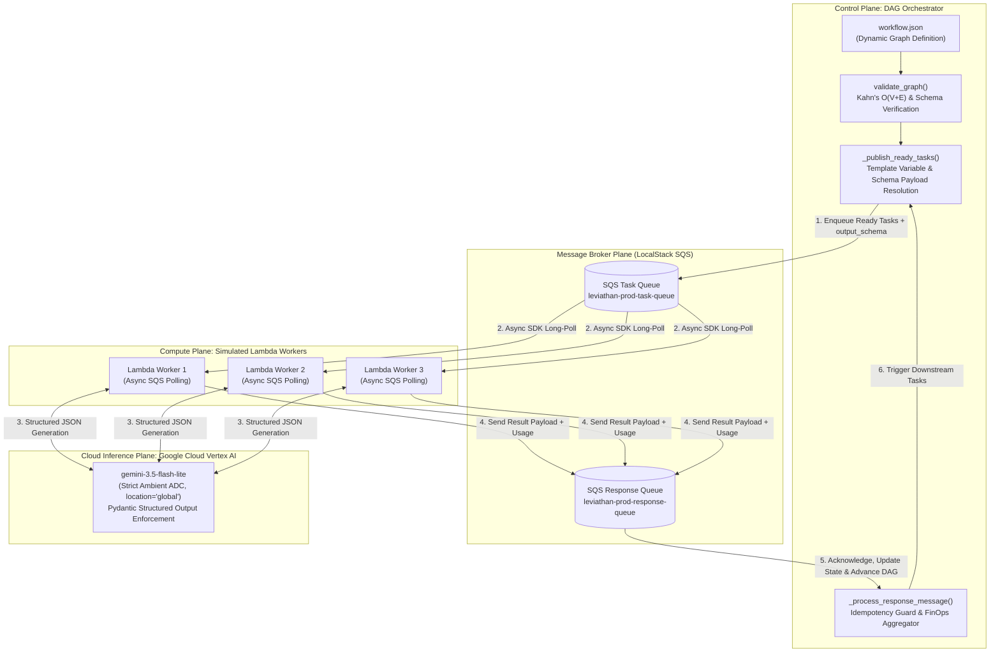

<div align="center">

# Project Leviathan
**Distributed Cloud-Native DAG Orchestrator & FinOps Workflow Engine**

[](#)
[](#)
[](#)
[](#)
[](#)
[](#)

*An enterprise-grade, asynchronous Directed Acyclic Graph (DAG) task engine featuring Pydantic structured output contracts, Kahn's algorithm deadlock prevention, BFS cascade cancellation, and cumulative FinOps token accounting.*

</div>

---

## 1. System Architecture

**Project Leviathan** completely decouples the **Orchestrator** (the Control Plane) from the **Execution Workers** (the Compute Plane) using an asynchronous message broker pattern backed by AWS SQS and emulated locally via LocalStack.



### Core Architectural Pillars
- **Strict Separation of Concerns:** The Orchestrator maintains DAG state, in-degrees, dependency resolution, and financial metering. Workers run stateless, asynchronously consuming tasks from SQS and communicating results back via a dedicated response queue.
- **Contract-First Pydantic Contracts:** Tasks declare explicit `output_schema` contracts (e.g. `TechSummary`, `ComparisonOutput`). Workers instruct Vertex AI to return constrained JSON via `response_schema` and validate responses before publishing.
- **Queue Message Semantics:** Distinguishes transient worker processing errors (retained in SQS for visibility-timeout redelivery) from terminal task payload failures (acknowledged and deleted from SQS to prevent queue poisoning).
- **FinOps Observability & Idempotency:** Tracks cumulative prompt, completion, and total tokens across all retry attempts. Idempotency guards discard duplicate SQS deliveries without double-counting financial metrics.

---

## 2. Algorithmic Foundations

### 2.1 Kahn's Algorithm for Topological Ordering & Cycle Detection
Before execution begins, `validate_graph()` maps tasks into an in-degree map and adjacency list, executing Kahn's algorithm in linear time using a double-ended queue (`collections.deque`):

$$\mathcal{O}(|V| + |E|)$$

Where $|V|$ is the number of task nodes and $|E|$ is the number of dependency edges. If the number of topologically sorted nodes does not equal $|V|$, a cycle exists, and the orchestrator halts immediately before sending messages over the network.

### 2.2 Pre-Flight Contract & Template Verification
The validator parses prompt template variables using `string.Formatter().parse(prompt)`:
1. Verifies that every referenced dependency `{dep}` is explicitly declared in `node.dependencies`.
2. Inspects dot-notation attribute references (e.g. `{fetch_aws.summary}`), ensuring that `summary` is a declared field in the dependency's `output_schema`. Typographical errors in field names fail at startup.

### 2.3 BFS Failure Cascade Cancellation
When a task fails terminally across all retry attempts:
1. The failed task is marked `TaskStatus.FAILED`.
2. Breadth-First Search (BFS) traverses the adjacency list, marking all transitive downstream descendants as `TaskStatus.CANCELLED`.
3. Orthogonal, independent DAG branches continue execution unimpeded.

### 2.4 Exponential Backoff with Random Jitter
Worker LLM invocations absorb transient network or quota errors using exponential backoff with full jitter:

$$T_{\text{wait}} = \left( 2^n \right) + \text{Uniform}(0.1, 1.0)$$

Where $n \in \{1, 2, 3\}$ is the attempt counter, preventing thundering herd spikes against the model API.

---

## 3. Pydantic Structured Output Contracts

Tasks define typed contracts in `models.py` registered in `SCHEMA_REGISTRY`:

```python
class TechSummary(BaseModel):
    service_name: str = Field(description="Official name of the service or technology")
    summary: str = Field(description="2-sentence architectural summary")
    key_characteristics: List[str] = Field(default_factory=list, description="Key architectural traits")

class ComparisonOutput(BaseModel):
    comparison_summary: str = Field(description="Comparative analysis of the technologies")
    key_differences: List[str] = Field(default_factory=list, description="Key operational differences")
    recommendation: str = Field(description="Concluding recommendation or takeaway")

SCHEMA_REGISTRY = {
    "TechSummary": TechSummary,
    "ComparisonOutput": ComparisonOutput,
}
```

### Context Passing via `ResultWrapper`
When a downstream node references `{fetch_aws.summary}`, `ResultWrapper` dynamically provides attribute-level access to structured fields while maintaining full stringification compatibility:
```python
class ResultWrapper(dict):
    def __getattr__(self, name: str):
        if name in self:
            val = self[name]
            return ResultWrapper(val) if isinstance(val, dict) else val
        raise AttributeError(f"Field '{name}' not found in task result.")
```

---

## 4. Cumulative FinOps Metering & Pricing Model

Leviathan tracks cloud spend with precision, implementing strict rules against misleading reporting:

1. **Cumulative Retry Accumulation:** If attempt 1 consumes 150 prompt tokens and fails JSON schema validation, those tokens are added to `cum_prompt_tokens` before attempt 2 executes.
2. **Missing Usage Handling:** If `usage_metadata` is missing or `None` from the API response, the task explicitly records:
   ```json
   {
     "status": "UNKNOWN",
     "prompt_tokens": null,
     "candidates_tokens": null,
     "total_tokens": null,
     "cost_usd": null
   }
   ```
   This prevents the engine from claiming $0.00 cost when unmetered API calls occurred.
3. **Duplicate Delivery Protection:** When AWS SQS delivers a message more than once (at-least-once delivery semantics), the orchestrator checks if the node is already in a terminal state (`COMPLETED`, `FAILED`, `CANCELLED`). If so, the message is deleted from the queue immediately without incrementing FinOps metrics.
4. **Configurable Pricing Rates:** Pricing rates are loaded from the environment:
   - `MODEL_INPUT_PRICE_PER_M="0.30"` ($0.30 per 1M prompt tokens)
   - `MODEL_OUTPUT_PRICE_PER_M="2.50"` ($2.50 per 1M output tokens)

### Empirical Live Execution Telemetry
Executing the full 3-task pipeline (`workflow.json`) live against Google Cloud Vertex AI ADC (`gemini-3.5-flash-lite`, multi-region `global`) produced the following telemetry:

```
==========================================
📊 [ENGINE] LEVIATHAN FINOPS EXECUTION SUMMARY
==========================================
💰 Total Prompt Tokens     : 579
💰 Total Completion Tokens : 403
💰 Total Token Spend       : 982
💵 Total Cloud Cost (USD)  : $0.001181
==========================================
```

- **Duplicate SQS Handling:** An emulated duplicate delivery of `fetch_gcp` was received and safely acknowledged without double-counting.
- **Total Pipeline Execution Cost:** Less than **$0.0012** for the complete multi-stage analysis.

---

## 5. Setup & Verification Instructions

### Prerequisites
- Python 3.12+ inside a virtual environment (`venv`).
- Docker Desktop (for LocalStack SQS emulation).
- Google Cloud Application Default Credentials (ADC) configured (`gcloud auth application-default login`).

### 1. Environment Configuration (`.env`)
```bash
VERTEX_PROJECT_ID="project-6d3877ae-baae-4159-a77"
VERTEX_LOCATION="global"
GEMINI_MODEL_ID="gemini-3.5-flash-lite"
MODEL_INPUT_PRICE_PER_M="0.30"
MODEL_OUTPUT_PRICE_PER_M="2.50"
LOCALSTACK_ENDPOINT="http://localhost:4566"
AWS_REGION="us-east-1"
```

### 2. Run Automated Regression Suite (100% Offline)
The test suite executes hermetically without network or cloud credentials:
```bash
./venv/bin/pytest tests/ -v
```
*Result: 24 passed in ~1.4s (Kahn's cycle validation, diamond graph cascade cancellation, transient vs terminal SQS semantics, duplicate message idempotency, Pydantic validation retries, and FinOps unknown status handling).*

### 3. Start LocalStack AWS SQS Emulator
```bash
docker compose up -d
```

### 4. Run Live Cloud-Native Pipeline
```bash
./venv/bin/python core.py
```

---

## 6. Project Structure

```
Leviathan/
├── infrastructure/
│   └── main.tf              # Terraform definitions for SQS queues
├── tests/
│   ├── test_dag.py          # Kahn's algorithm, BFS cascade, and SQS queue semantics
│   └── test_structured_dag.py # Pydantic contracts, retry accounting, and FinOps idempotency
├── core.py                  # Distributed Orchestrator, Lambda Worker, and FinOps Engine
├── genai_client.py          # Strict Google Vertex AI ADC client factory
├── models.py                # Pydantic schemas (TechSummary, ComparisonOutput)
├── workflow.json            # Dynamic DAG definition with schema contracts
├── docker-compose.yml       # LocalStack SQS container configuration
└── requirements.txt         # Dependencies (aioboto3, pydantic, google-genai)
```

---

<p align="center">
  <i>Developed and engineered by <b>Garv Vaidya</b> · <a href="https://github.com/kleeeoss">GitHub Workspace</a></i>
</p>
